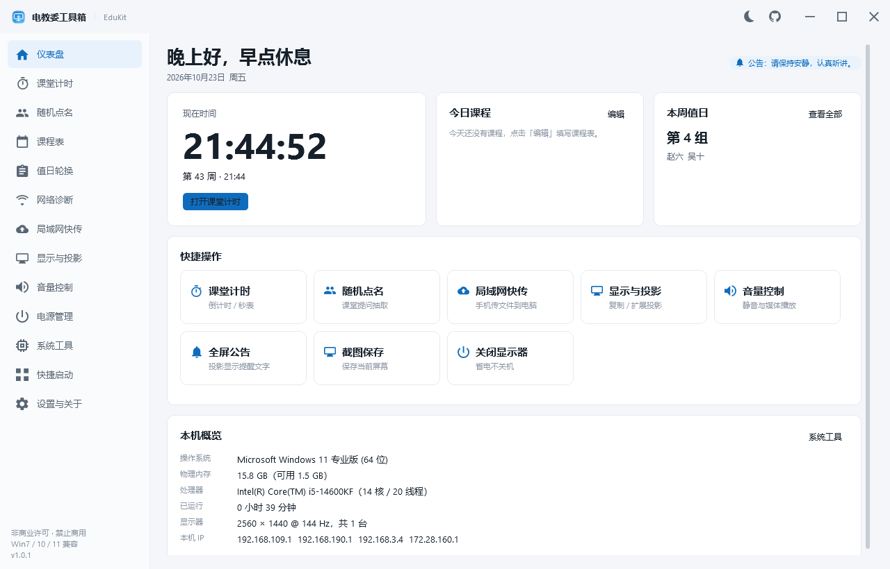
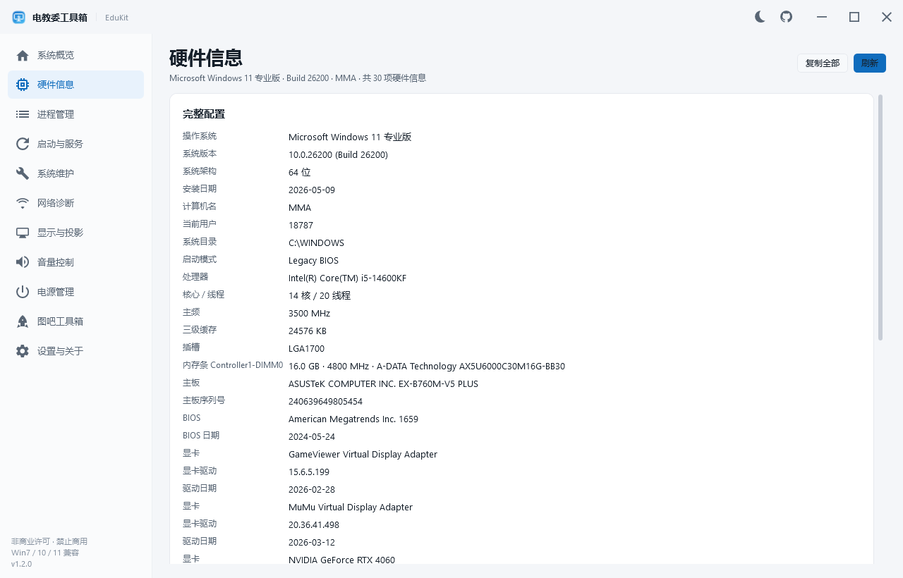
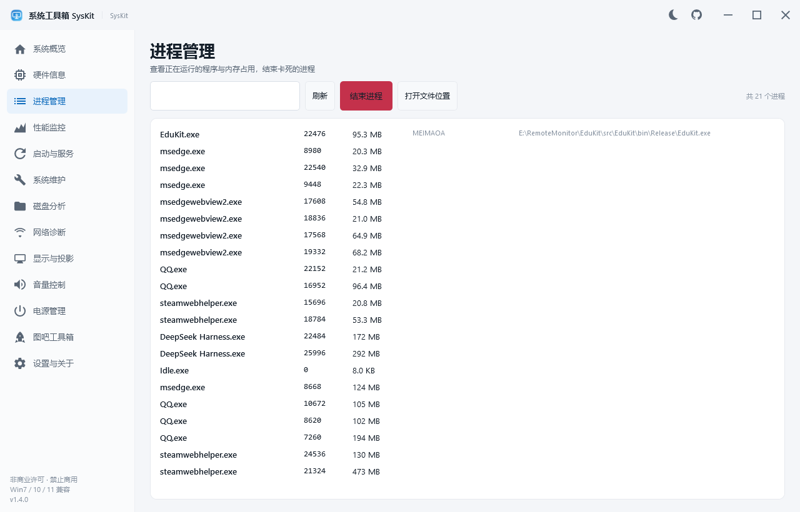
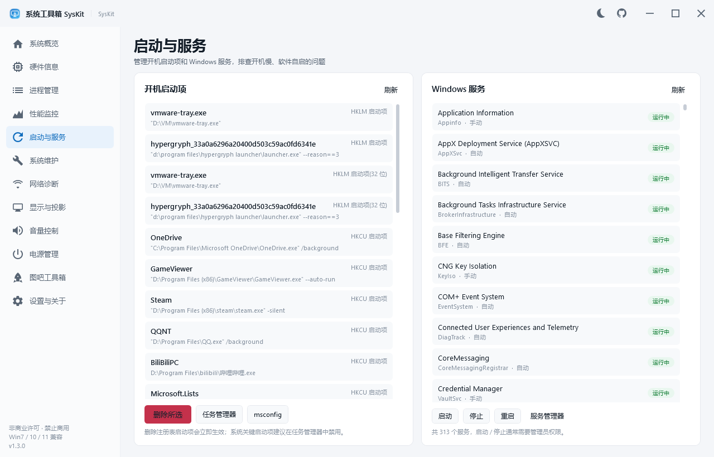
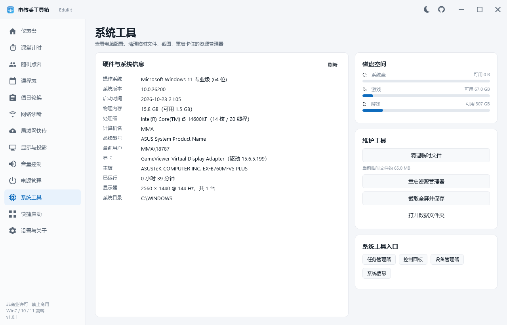
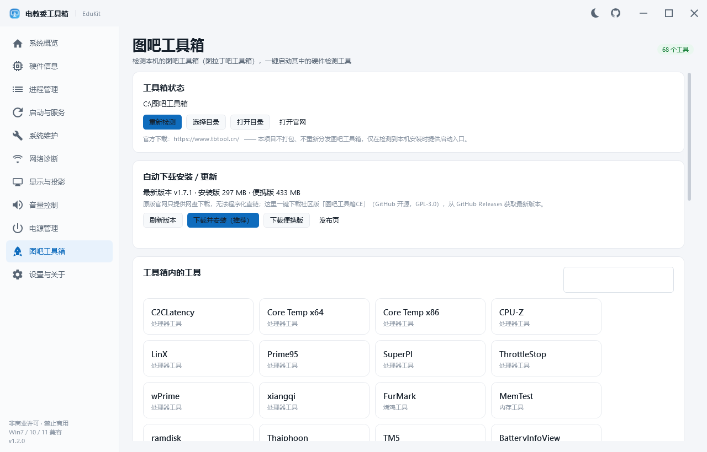
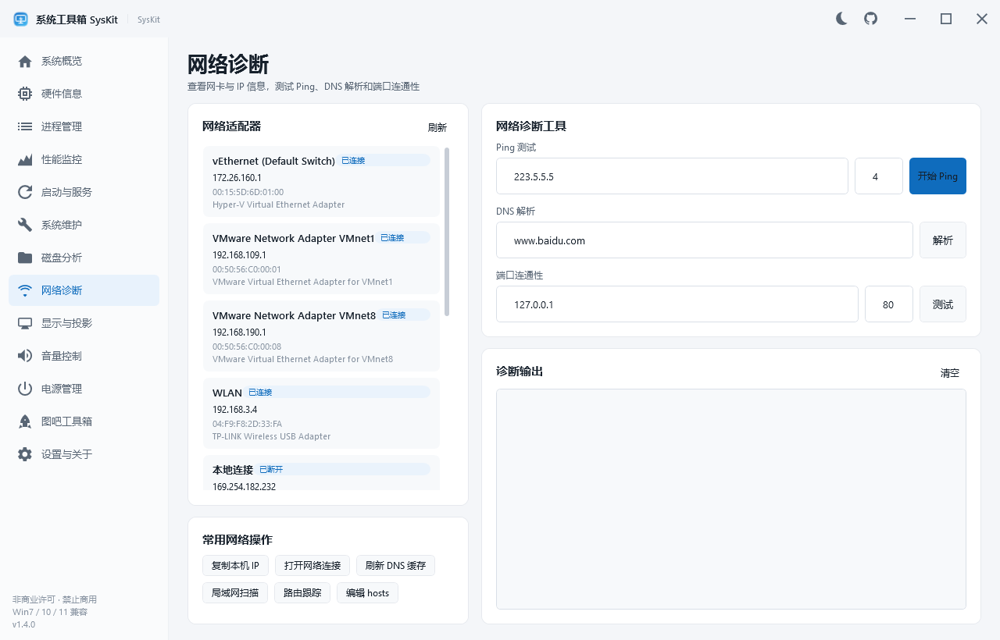
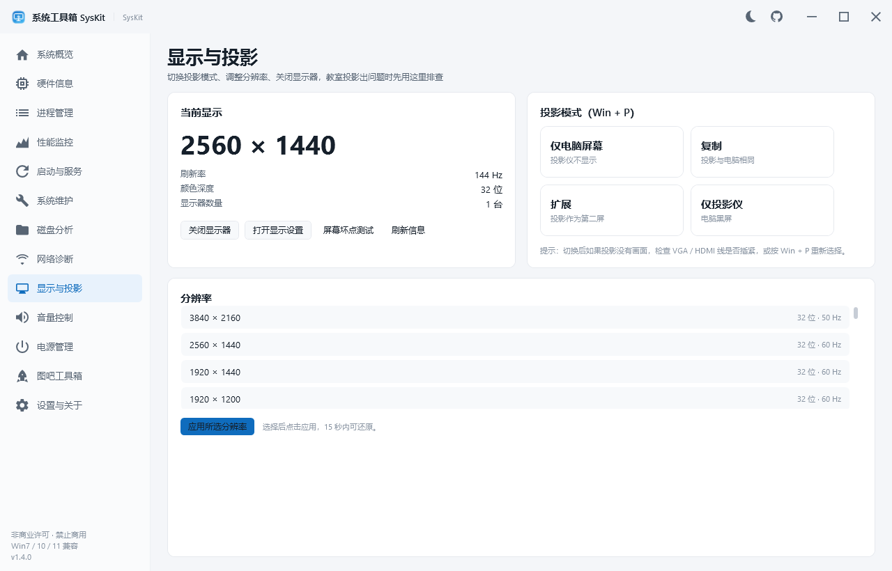
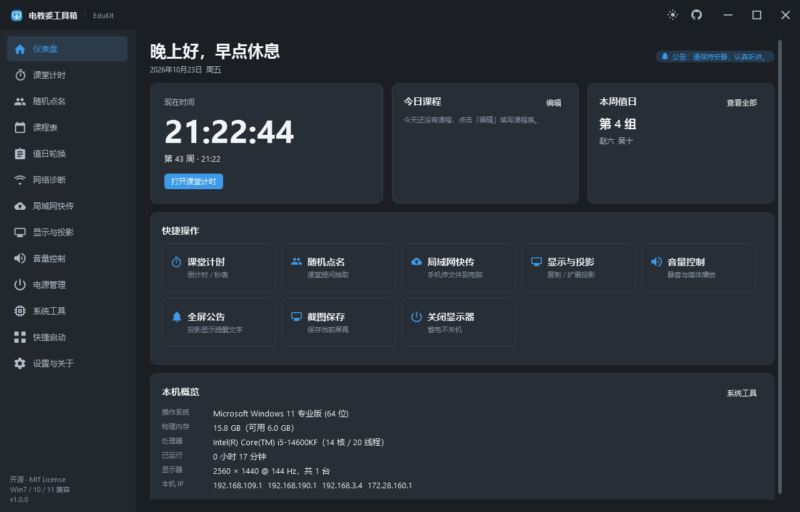
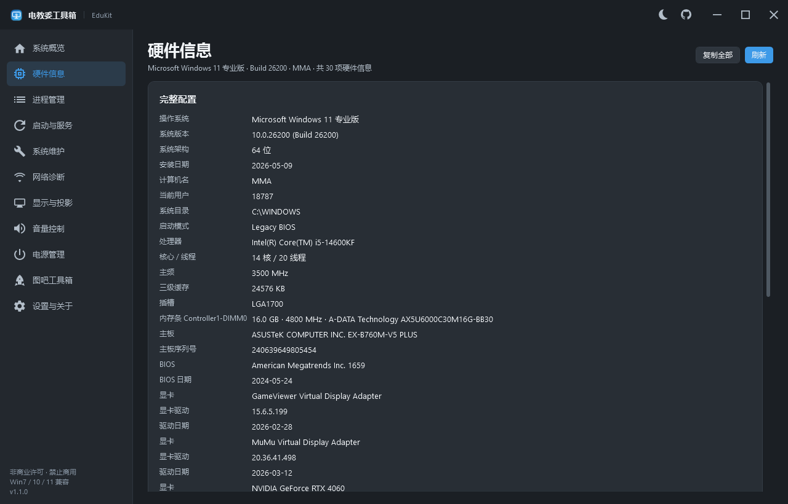

# 电教委工具箱 · EduKit

> 面向班级电教委员（电教委）与电脑维护人员的 Windows **专业系统工具箱**：系统概览、硬件信息、进程管理、启动项与服务、系统维护、网络诊断、显示与投影、音量、电源、屏幕测试，并集成图吧工具箱入口。
>
> 支持 **Windows 7 SP1 / 8 / 8.1 / 10 / 11**，32 位 / 64 位，UTF-8 中文界面，非商业许可开源（PolyForm Noncommercial 1.0.0，禁止商业使用）。

[](#兼容性说明)
[](https://dotnet.microsoft.com/download/dotnet-framework)
[](LICENSE)
[](https://github.com/MEIMAOA/EduKit/releases)
[](https://github.com/MEIMAOA/EduKit/actions/workflows/build.yml)



---

## v1.1.0 更新：只保留专业系统功能

根据反馈，v1.1.0 移除了课堂计时、随机点名、课程表、值日轮换、局域网快传、快捷启动等与系统维护无关的模块，专注专业系统类功能，并新增：

- **硬件信息**：CPU / 内存条 / 主板 / BIOS / 显卡 / 电池 / 磁盘健康 / 设备问题 / 系统激活状态；
- **进程管理**：进程列表、内存占用、文件路径，支持搜索与结束进程；
- **启动与服务**：注册表启动项、启动文件夹、Windows 服务启动/停止/重启；
- **系统维护**：磁盘空间、缓存清理（临时文件 / 缩略图 / 错误报告 / 回收站 / Windows 更新缓存）、SFC / DISM / 网络重置 / 系统还原 / 事件查看器 / 蓝屏转储；
- **屏幕坏点测试**：全屏纯色循环，检查投影仪、显示器的坏点与色彩；
- **图吧工具箱集成**：自动检测本机已安装的图吧工具箱，按分类列出工具并一键启动；支持**在程序内自动下载安装 / 更新图吧工具箱CE**（GitHub 开源版，GPL-3.0），也可手动选择目录或打开官网；
- **触控优化**：手指上下滑动支持惯性滚动，鼠标滚轮 / 触控板双指滑动改为平滑动画，长列表使用像素滚动。

---

## 为什么不是 WinUI 3 / WinUI 2？

需求要求支持 Windows 7。核对微软官方支持矩阵：

| 技术 | 最低系统要求 | 能否支持 Win7 |
| --- | --- | --- |
| WinUI 3 / Windows App SDK | Windows 10 1809（17763） | ❌ 不支持 |
| WinUI 2（UWP 控件库） | Windows 10（UWP 平台） | ❌ 不支持 |
| WPF（.NET Framework） | Windows 7 SP1 / .NET Framework 4.6.2 | ✅ 支持 |

因此采用 **WPF（.NET Framework 4.6.2） + 自绘 WinUI / Fluent 风格主题**：左侧导航、圆角卡片、亮/暗主题、矢量图标（不依赖 Win10 才有的 Segoe MDL2 字体）、自绘标题栏，在 Windows 7 的经典主题与 Aero 主题下都能正常显示。

---

## 功能一览

| 模块 | 主要功能 |
| --- | --- |
| 🏠 系统概览 | 处理器 / 内存 / 显卡 / 系统 / 运行时长、磁盘空间、设备问题、图吧工具箱状态、常用工具入口 |
| 🔧 硬件信息 | 完整配置（系统、CPU 核心线程/主频/缓存/插槽、内存条容量/频率/品牌/型号、主板/BIOS、显卡与驱动日期、电池）、磁盘型号与健康、有问题的设备、一键复制 |
| 📋 进程管理 | 进程列表（名称 / PID / 内存 / 公司 / 路径）、搜索、结束进程（二次确认）、打开文件位置 |
| ⚙ 启动与服务 | 开机启动项（HKLM / HKCU / 32 位 / 启动文件夹）、删除启动项、任务管理器 / msconfig 入口、Windows 服务列表（状态 / 启动类型）、启动 / 停止 / 重启服务 |
| 🧹 系统维护 | 磁盘空间与型号、缓存与垃圾清理（安全项一键清理、含管理员项、磁盘清理）、SFC、DISM、重置网络、刷新 DNS、系统还原、事件查看器、蓝屏转储目录、设备管理器、服务管理、系统信息 |
| 📶 网络诊断 | 网卡 / IP / MAC / 网关 / 速率、Ping（次数、平均/最小/最大延迟）、DNS 解析、TCP 端口连通性、复制本机 IP、打开网络连接、刷新 DNS 缓存 |
| 🖥 显示与投影 | 分辨率 / 刷新率 / 色深 / 显示器数量、复制 / 扩展 / 仅电脑 / 仅投影、分辨率切换（15 秒自动还原保护）、关闭显示器、**屏幕坏点测试**、打开显示设置 |
| 🔊 音量控制 | 系统主音量（Core Audio）、静音、20/50/80/100% 预设、上一首 / 播放暂停 / 下一首 / 停止、音量合成器、测试提示音 |
| 🔌 电源管理 | 关机 / 重启 / 注销 / 睡眠 / 锁屏 / 关闭显示器（全部二次确认）、定时关机 / 重启 / 取消定时、倒计时显示 |
| 🚀 图吧工具箱 | 自动检测本机图吧工具箱、按分类列出工具（CPU-Z / AIDA64 / HWiNFO / CrystalDiskInfo / DiskGenius / FurMark / Prime95 等）、一键启动、**自动下载安装 / 更新图吧工具箱CE**、手动选择目录、打开官网（https://www.tbtool.cn/） |
| ⚙ 设置与关于 | 亮/暗主题、开机自启（注册表 Run，免管理员）、打开数据目录、恢复默认设置、检查更新（GitHub Releases）、开源协议信息 |

---

## 触控与滚动手感优化

Windows 7 到 Windows 11 的触屏设备、触控板都能获得一致的顺滑体验：

- 所有滚动区域默认开启 `PanningMode.VerticalFirst` 惯性平移，手指上下滑动即可滚动；
- 自研 `SmoothScrollViewer`：鼠标滚轮 / 触控板双指滑动使用缓动动画，不再一格一格跳动；
- 列表使用像素滚动，长列表滑动更细腻；
- 惯性减速率与位移比例针对触控调校（`PanningDeceleration=0.001`）。

---

## 图吧工具箱集成说明

- 程序会在常见位置自动查找本机图吧工具箱（如 `C:\图吧工具箱`、各盘符根目录、Program Files、桌面、下载目录、注册表卸载信息），也可以手动选择目录；
- 检测成功后自动扫描最新版本 `tools` 目录，按分类列出工具，点击即启动；
- **本项目不打包、不重新分发图吧工具箱及其任何第三方工具**，仅在本机已安装时提供启动入口；请从官网 [https://www.tbtool.cn/](https://www.tbtool.cn/) 下载图吧工具箱，并遵守其自身许可协议；
- 硬件检测类工具（CPU-Z、AIDA64、CrystalDiskInfo 等）由对应厂商提供，请遵守各自许可。

---

## 界面预览

| 系统概览 | 硬件信息 |
| --- | --- |
|  |  |

| 进程管理 | 启动与服务 |
| --- | --- |
|  |  |

| 系统维护 | 图吧工具箱 |
| --- | --- |
|  |  |

| 网络诊断 | 显示与投影 |
| --- | --- |
|  |  |

**暗色主题：**

| 系统概览 | 硬件信息 |
| --- | --- |
|  |  |

> 所有截图由程序自带的离屏截图模式（`--render`）自动生成，未经过任何后期处理。

---

## 快速开始

1. 打开 [Releases](https://github.com/MEIMAOA/EduKit/releases) 下载最新的 `EduKit-v1.2.0.zip`；
2. 解压到任意目录（建议不要放在 `C:\Program Files`，避免权限问题）；
3. 双击 `EduKit.exe` 运行。

### 环境要求

- Windows 7 SP1 / 8 / 8.1 / 10 / 11，32 位或 64 位；
- .NET Framework **4.6.2 或更高版本**（Windows 10/11 通常已自带 4.8）；
- Windows 7 用户如提示缺少 .NET Framework，请先安装 [.NET Framework 4.8（微软官方，支持 Win7 SP1）](https://dotnet.microsoft.com/download/dotnet-framework/net48)；
- 首次运行会在 `%APPDATA%\EduKit` 创建数据目录；如果该目录不可写（例如受管控的电脑），程序会自动回退到 `%LOCALAPPDATA%\EduKit` 或程序目录下的 `EduKitData`，并在「设置」页显示实际数据目录。

### 权限说明

- 程序默认以普通权限运行，浏览硬件信息、进程、启动项、网络诊断、显示与音量等功能都不需要管理员权限；
- SFC / DISM / 重置网络 / 启动或停止服务 / 清理 Windows 更新缓存等操作需要管理员权限，点击相应按钮时会弹出 UAC 提权提示。

---

## 从源码构建

### 环境

- Windows 10/11（编译 WPF + .NET Framework 目标需要 Windows）；
- [.NET SDK 8.0 或更高版本](https://dotnet.microsoft.com/download)（本项目使用 10.0.401 验证；也可以用 Visual Studio 2019+ 打开 `EduKit.sln`）；
- Windows 7 目标需要 .NET Framework 4.6.2 开发者包 / 引用程序集（.NET SDK 会自动通过 NuGet 还原）。

### 命令

```powershell
git clone https://github.com/MEIMAOA/EduKit.git
cd EduKit

# 编译（Debug / Release）
dotnet build EduKit.sln -c Release

# 生成发布压缩包（Release 编译 + 打包到 dist/EduKit-v1.2.0.zip）
powershell -ExecutionPolicy Bypass -File .\build.ps1
```

构建产物在 `src/EduKit/bin/Release/EduKit.exe`，发布包在 `dist/EduKit-v1.2.0.zip`。

### 自检与截图模式

```powershell
# 冒烟自检：配置读写、硬件信息、进程/服务/启动项、网络、显示、音量、清理、图吧工具箱扫描
.\src\EduKit\bin\Release\EduKit.exe --selftest .\selftest.txt

# 离屏渲染全部页面截图（窗口在屏幕外，不会打扰用户）
.\src\EduKit\bin\Release\EduKit.exe --render .\docs\shots
```

自检报告示例见 [docs/VERIFICATION.md](docs/VERIFICATION.md)。

---

## 项目结构

```text
EduKit/
├─ EduKit.sln
├─ build.ps1                     # 一键编译 + 打包
├─ src/EduKit/
│  ├─ App.xaml(.cs)              # 应用入口、单实例、全局异常日志
│  ├─ MainWindow.xaml(.cs)       # 自绘标题栏 + 侧栏导航 + 页面缓存
│  ├─ Screenshots.cs             # --render 离屏截图
│  ├─ Themes/                    # 亮/暗色资源 + Fluent 控件样式 + 矢量图标
│  ├─ Controls/                  # 矢量图标按钮、触控平滑滚动容器
│  ├─ Core/                      # 配置、P/Invoke、音量、硬件信息、进程/服务、清理、图吧集成、自检
│  ├─ Views/                     # 11 个功能页面 + 屏幕坏点测试窗口
│  └─ Assets/EduKit.ico          # 程序图标（tools/make-icon.ps1 生成）
├─ tools/make-icon.ps1           # 图标生成脚本
└─ docs/shots/                   # README 截图
```

## 技术实现要点

- **零第三方依赖**：仅使用 .NET Framework 自带程序集，发布包只有 `EduKit.exe` + 配置/图标，拷贝即用；
- **配置持久化**：内置 `DataContractJsonSerializer` 存 JSON，人类可读、便于备份；
- **硬件信息**：WMI（`Win32_Processor` / `PhysicalMemory` / `BaseBoard` / `BIOS` / `VideoController` / `Battery` / `PnPEntity` / `LogicalDisk` 等）+ 注册表 + Win32，读取失败自动跳过单项，不影响界面；
- **系统音量**：COM 互操作 `IAudioEndpointVolume`（Windows 7+ Core Audio API），失败时自动降级为媒体键；
- **服务管理**：`ServiceController` + 注册表读取启动类型；
- **系统清理**：临时目录、Windows Update 缓存、错误报告、缩略图缓存、回收站（Shell32 `SHQueryRecycleBin` / `SHEmptyRecycleBin`）；
- **显示控制**：`EnumDisplaySettings` / `ChangeDisplaySettings`、`DisplaySwitch.exe`、`WM_SYSCOMMAND + SC_MONITORPOWER`；
- **电源控制**：`shutdown.exe`、`SetSuspendState`、`LockWorkStation`；
- **触控滚动**：`PanningMode` 惯性平移 + 自研 `SmoothScrollViewer` 缓动滚动；
- **主题切换**：两套 `ResourceDictionary` 运行时替换，全部控件使用 `DynamicResource`；
- **Windows 7 兼容**：不引用任何 Win10+ API，图标使用矢量 `Geometry` 而非 Segoe MDL2，标题栏自绘，`Prefer32Bit` 保证在老机器上运行。

## 兼容性说明

- 开发与测试环境：Windows 11 26200（.NET Framework 4.8 / .NET SDK 10.0.401）；
- 目标框架 `net462`，程序清单声明兼容 Windows 7 / 8 / 8.1 / 10 / 11；
- 程序以 `asInvoker` 普通权限运行；需要管理员的维护操作会单独弹 UAC；
- 若教室电脑没有 .NET Framework 4.6.2+，请先安装运行库。

## 常见问题

**Q：Windows 7 能运行吗？**
可以。需要 Windows 7 **SP1** 并安装 .NET Framework 4.6.2 或更高版本（推荐 4.8）。项目不使用 Win10 独占 API。

**Q：为什么不用 WinUI 3？**
WinUI 3 / WinUI 2 均不支持 Windows 7，详见上文说明。本项目用 WPF 自绘 Fluent 风格，视觉接近 WinUI。

**Q：图吧工具箱显示"未检测到"？**
程序会在常见位置自动查找，如果放在自定义位置，请到「图吧工具箱」页面点击「选择目录」手动指定，目录选到包含 `图吧工具箱20xx` 文件夹的外层目录即可。也可以直接从官网 [https://www.tbtool.cn/](https://www.tbtool.cn/) 下载安装。

**Q：自动下载安装图吧工具箱失败？**
请确认网络可以访问 GitHub（github.com / pi.github.com）。如果网络受限，可点击「发布页」手动下载，或在原版官网（https://www.tbtool.cn/）使用网盘下载。下载约 300 MB，请预留磁盘空间。

**Q：自动更新 EduKit 失败？**
自动更新需要程序目录可写（不要把程序放在 Program Files），且需要能访问 GitHub。更新失败时不会影响当前版本运行；可以到 Releases 页面手动下载最新 zip 覆盖。

**Q：清理或服务操作提示需要管理员权限？**
涉及系统目录、Windows 更新缓存、系统服务的操作需要管理员权限，点击时选择"是"即可提权；浏览类功能不需要管理员权限。

**Q：触屏滑动不跟手？**
程序已为所有滚动区域开启惯性平移并加了平滑滚动。如果仍然卡顿，可能是老机器的显示驱动或屏体本身限制，可尝试关闭动画（Windows 性能选项）后重启程序。

**Q：数据在哪里？怎么备份？**
默认 `%APPDATA%\EduKit`（受管控电脑会自动回退）。「设置 → 打开数据文件夹」可直接跳转；复制该目录即可备份，删除即恢复初始状态。

**Q：会不会被杀毒软件误报？**
程序不做任何联网上传、不修改系统关键项，源码完全公开可审计。个别杀软对未知小工具敏感，可将 EduKit 目录加入信任列表。

## 更新日志

### v1.2.0（2026-10-23）

- 新增**图吧工具箱自动下载安装 / 更新**：从 GitHub Releases 获取图吧工具箱CE 最新版，支持安装版与便携版，带下载进度 / 速度 / 剩余时间与取消；
- 新增**EduKit 自动更新**：启动时自动检查、可开启自动下载安装、手动检查 / 立即更新，更新包 SHA256 校验后自动替换并重启；
- 设置页新增更新策略开关；图吧工具箱页面新增在线版本检测；
- 修复设置页副标题残留的旧功能描述；版本号 1.2.0，自检与截图更新。

### v1.1.0（2026-10-23）

- **产品定位调整**：移除课堂计时、随机点名、课程表、值日轮换、局域网快传、快捷启动等非系统模块，只保留专业系统类功能；
- 新增硬件信息、进程管理、启动与服务、系统维护（清理/修复）、屏幕坏点测试；
- 新增图吧工具箱本地检测、分类扫描与一键启动（不重新分发第三方程序）；
- 新增触控/触控板平滑滚动与惯性平移；
- 界面改为系统概览首页，11 个模块重新梳理；截图全部重新生成。

### v1.0.1（2026-10-23）

- 许可证由 MIT 变更为 **PolyForm Noncommercial 1.0.0**：个人、学生、教师以及学校等非商业组织可免费使用、修改和分发；**禁止任何商业用途**；
- 软件内「侧栏 / 设置-关于」的开源协议标识同步更新；
- 商业使用需联系作者获得单独商业授权。

### v1.0.0（2026-10-23）

- 首个版本：课堂工具类 13 个模块、亮/暗色主题、Windows 7 兼容；
- 内置自检（`--selftest`）与离屏截图（`--render`）模式；
- 零第三方依赖，发布包单 exe 即用。

## English Summary

EduKit is a lightweight, professional Windows system toolbox for class IT/AV committee members and PC maintenance. It provides a system overview, detailed hardware inventory (CPU, memory modules, motherboard/BIOS, GPU, disks, device problems, activation), process manager, startup items and Windows services, system maintenance (cleanup, SFC/DISM, network reset), network diagnostics, display/projector control with a dead-pixel test, volume control and power management. It also detects a locally installed TuBa Toolbox (图吧工具箱), launches its tools without redistributing them, and can automatically download/install or update the community edition (图吧工具箱CE) from its GitHub Releases. EduKit can also self-update from its own GitHub Releases with SHA256 verification. It targets **.NET Framework 4.6.2** so it runs on **Windows 7 SP1 / 8 / 8.1 / 10 / 11**. WinUI 3 and WinUI 2 cannot run on Windows 7, so EduKit uses WPF with a hand-written WinUI/Fluent-style theme. Touch scrolling uses inertial panning and a custom smooth scroller. No third-party packages. Released under the PolyForm Noncommercial License 1.0.0: free for personal, educational and other noncommercial use, commercial use requires a separate license.

## 开源协议

本项目采用 **[PolyForm Noncommercial License 1.0.0](LICENSE)**（非商业许可）：

- ✅ **允许**：个人学习、教学、学校 / 公益组织 / 政府机构等**非商业**用途，可自由使用、修改、分发（分发时需保留许可证与 `Required Notice` 版权声明）；
- ❌ **禁止**：任何**商业用途**，包括但不限于打包销售、付费分发、增值服务、企业内部商业使用等；
- 💼 **商业授权**：如需商业使用，请通过 GitHub Issue 或邮箱联系作者，获取单独商业授权。

© 2026 [MEIMAOA](https://github.com/MEIMAOA)

> 说明：v1.0.0 曾以 MIT 协议发布，已经分发的 v1.0.0 副本仍适用 MIT；自 v1.0.1 起采用上述非商业许可。

欢迎 Star、Issue、PR。

## 参与贡献

欢迎参与！详见 [CONTRIBUTING.md](CONTRIBUTING.md)。
