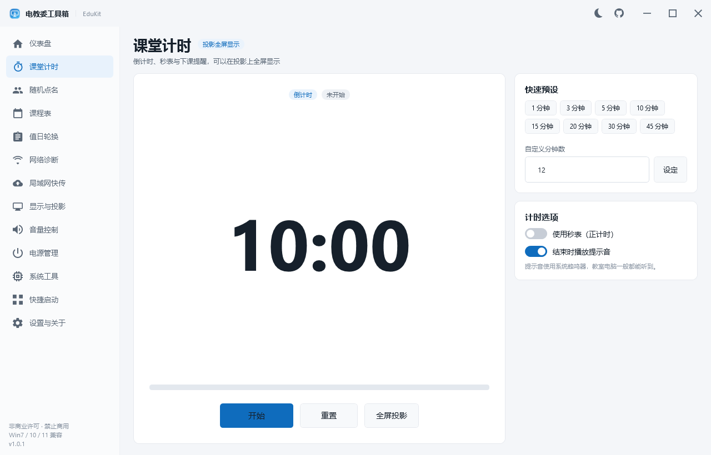
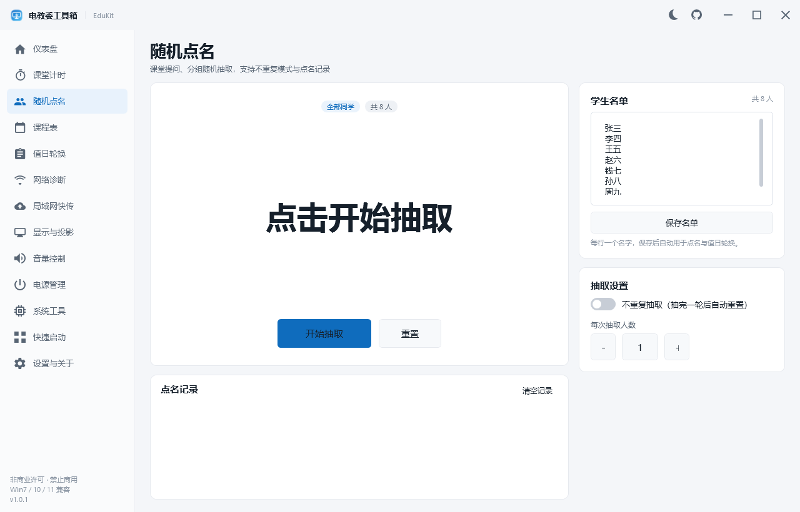
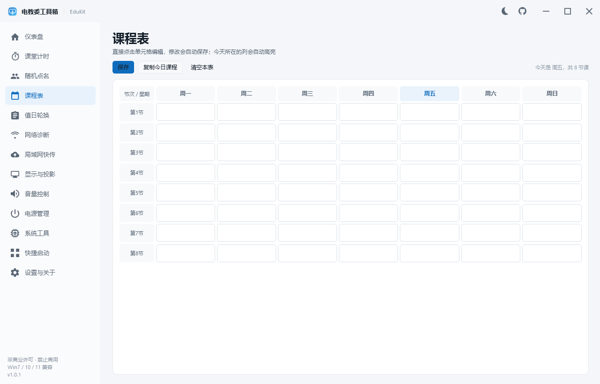
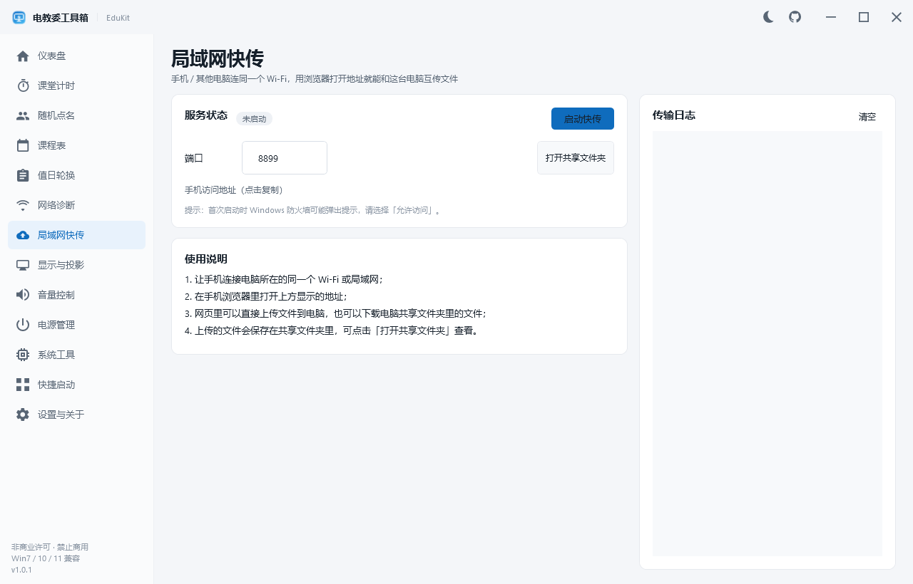
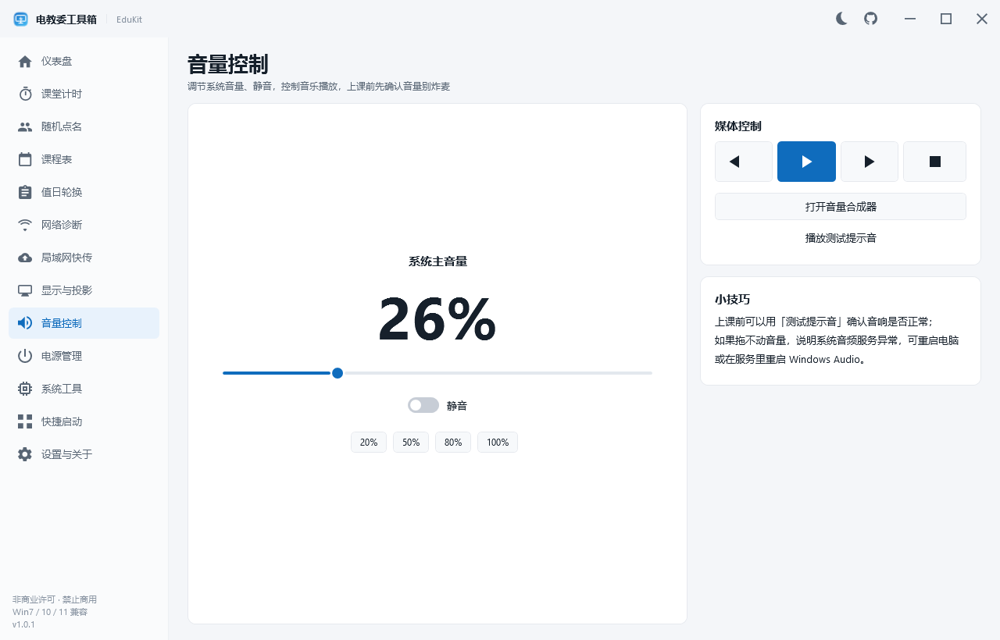
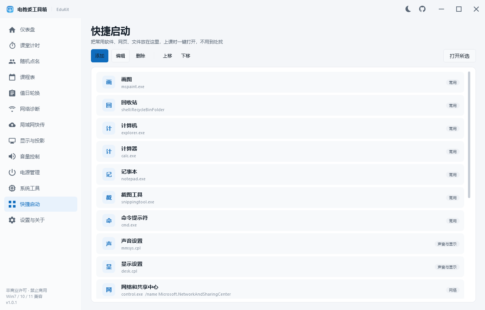
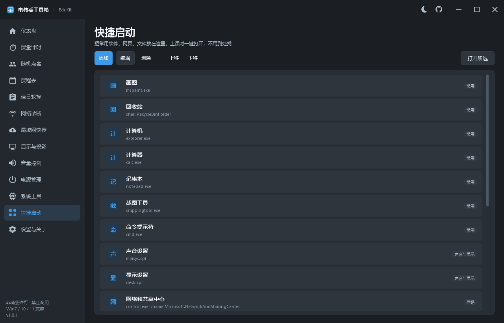

# 电教委工具箱 · EduKit

> 面向班级电教委员（电教委）的 Windows 桌面工具箱：课堂计时、随机点名、课程表、值日轮换、网络诊断、局域网快传、显示与投影、音量控制、电源管理、系统工具、快捷启动。
>
> 支持 **Windows 7 SP1 / 8 / 8.1 / 10 / 11**，32 位 / 64 位，UTF-8 中文界面，非商业许可开源（PolyForm Noncommercial 1.0.0，禁止商业使用）。

[](#兼容性说明)
[](https://dotnet.microsoft.com/download/dotnet-framework)
[](LICENSE)
[](https://github.com/MEIMAOA/EduKit/releases)
[](https://github.com/MEIMAOA/EduKit/actions/workflows/build.yml)


---

## 为什么不是 WinUI 3 / WinUI 2？

需求里要求「WinUI 3，不行就 WinUI 2，并且支持 Windows 7」。实际核对微软官方支持矩阵后：

| 技术 | 最低系统要求 | 能否支持 Win7 |
| --- | --- | --- |
| WinUI 3 / Windows App SDK | Windows 10 1809（17763） | ❌ 不支持 |
| WinUI 2（UWP 控件库） | Windows 10（UWP 平台） | ❌ 不支持 |
| WPF（.NET Framework） | Windows 7 SP1 / .NET Framework 4.6.2 | ✅ 支持 |

**WinUI 3 和 WinUI 2 都无法运行在 Windows 7 上**，这是框架层面的硬限制。因此本项目采用唯一能同时满足「现代 UI + Windows 7」的方案：

> **WPF（.NET Framework 4.6.2） + 自绘 WinUI / Fluent 风格主题**

界面按 WinUI 的视觉语言实现：左侧导航、圆角卡片、Fluent 配色、亮色/暗色主题、矢量图标（不依赖 Win10 才有的 Segoe MDL2 字体）、无边框自绘标题栏，保证在 Windows 7 的经典主题和 Aero 主题下都能正常显示。

---

## 功能一览

| 模块 | 主要功能 |
| --- | --- |
| 🏠 仪表盘 | 大时钟、日期/周次、今日课程、本周值日小组、本机概览、8 个常用快捷入口、全屏公告、截图 |
| ⏱ 课堂计时 | 倒计时 / 秒表、8 档快速预设 + 自定义分钟、暂停/继续/重置、进度条、结束提示音、**投影全屏显示**（大字号，到点变黄/变红） |
| 🎲 随机点名 | 名单导入/保存、单人或多人抽取、不重复模式（抽完一轮自动重置）、滚动动画、点名记录、一键清空 |
| 📅 课程表 | 7×8 可编辑表格、自动保存、今天所在列高亮、今日课程一键复制（粘贴到班级群）、清空表格 |
| 🧹 值日轮换 | 按名单自动平均分组（1–8 组）、按 ISO 周号自动轮换、手动上一组/下一组、本周值日高亮 |
| 📶 网络诊断 | 网卡/IP/MAC/网关/速率列表、Ping 测试（次数、平均/最小/最大延迟）、DNS 解析、TCP 端口连通性、复制本机 IP、打开网络连接、刷新 DNS 缓存 |
| 📤 局域网快传 | 内置 HTTP 服务（无需管理员、不依赖 http.sys）、手机浏览器上传/下载/删除文件、拖拽上传、进度条、传输日志 |
| 🖥 显示与投影 | 当前分辨率/刷新率/色深/显示器数量、复制/扩展/仅电脑/仅投影（Win+P 等效）、分辨率切换（15 秒自动还原保护）、关闭显示器、打开显示设置 |
| 🔊 音量控制 | 系统主音量滑条（Core Audio API）、静音开关、20/50/80/100% 预设、上一首/播放暂停/下一首/停止、打开音量合成器、测试提示音 |
| 🔌 电源管理 | 关机/重启/注销/睡眠/锁屏/关闭显示器（全部二次确认）、定时关机/重启/取消定时、倒计时状态显示 |
| 🛠 系统工具 | WMI 硬件信息（系统/CPU/内存/显卡/主板/运行时长/IP）、磁盘空间、清理临时文件、重启资源管理器、全屏截图保存、系统工具入口 |
| 🚀 快捷启动 | 内置 16 个常用系统工具、自定义添加程序/网址/文件/`shell:` 位置、排序、双击启动、分类标签 |
| ⚙ 设置与关于 | 亮/暗主题切换、开机自启（注册表 Run，免管理员）、局域网端口、打开数据目录、恢复默认设置、检查更新（GitHub Releases）、开源信息 |

---

## 界面预览

| 课堂计时 | 随机点名 |
| --- | --- |
|  |  |

| 课程表 | 局域网快传 |
| --- | --- |
|  |  |

| 显示与投影 | 音量控制 |
| --- | --- |
|  |  |

| 系统工具 | 快捷启动 |
| --- | --- |
|  |  |

**暗色主题：**

| 仪表盘 | 快捷启动 |
| --- | --- |
|  |  |

> 所有截图由程序自带的离屏截图模式（`--render`）自动生成，未经过任何后期处理。

---

## 快速开始

### 直接使用

1. 打开 [Releases](https://github.com/MEIMAOA/EduKit/releases) 下载最新的 `EduKit-v1.0.1.zip`；
2. 解压到任意目录（建议不要放在 `C:\Program Files`，避免权限问题）；
3. 双击 `EduKit.exe` 运行。

### 环境要求

- Windows 7 SP1 / 8 / 8.1 / 10 / 11，32 位或 64 位；
- .NET Framework **4.6.2 或更高版本**（Windows 10/11 通常已自带 4.8）；
- Windows 7 用户如提示缺少 .NET Framework，请先安装：
  - [.NET Framework 4.8 在线安装包（微软官方，支持 Win7 SP1）](https://dotnet.microsoft.com/download/dotnet-framework/net48)
- 首次运行会在 `%APPDATA%\EduKit` 创建数据目录；如果该目录不可写（例如受管控的电脑），程序会自动回退到 `%LOCALAPPDATA%\EduKit` 或程序目录下的 `EduKitData`，并在「设置」页显示实际数据目录。

### 首次使用建议

1. 打开「随机点名」，在右侧「学生名单」里每行输入一个名字，点「保存名单」；
2. 打开「课程表」，把这学期的课填进去（会自动保存）；
3. 打开「局域网快传」，点「启动快传」，手机连同一个 Wi-Fi 后用浏览器打开显示的地址即可互传文件；
4. 打开「设置」，按需开启「开机自动启动」、切换深色主题。

---

## 从源码构建

### 环境

- Windows 10/11（编译 WPF + .NET Framework 目标需要 Windows）；
- [.NET SDK 8.0 或更高版本](https://dotnet.microsoft.com/download)（本项目使用 10.0.401 验证；也可以用 Visual Studio 2019+ 打开 `EduKit.sln`）；
- Windows 7 目标需要 .NET Framework 4.6.2 开发者包 / 引用程序集（.NET SDK 会自动通过 NuGet 还原）。

### 命令

```powershell
git clone https://github.com/MEIMAOA/EduKit.git
cd EduKit

# 编译（Debug / Release）
dotnet build EduKit.sln -c Release

# 生成发布压缩包（Release 编译 + 打包到 dist/EduKit-v1.0.1.zip）
powershell -ExecutionPolicy Bypass -File .\build.ps1
```

构建产物在 `src/EduKit/bin/Release/EduKit.exe`，发布包在 `dist/EduKit-v1.0.1.zip`。

### 自检与截图模式

程序内置两个无界面模式，便于验证和生成文档图片：

```powershell
# 冒烟自检：配置读写、WMI、网卡、显示、音量、局域网快传 HTTP 端到端
.\src\EduKit\bin\Release\EduKit.exe --selftest .\selftest.txt

# 离屏渲染全部页面截图（窗口在屏幕外，不会打扰用户）
.\src\EduKit\bin\Release\EduKit.exe --render .\docs\shots
```

自检报告示例见 [docs/VERIFICATION.md](docs/VERIFICATION.md)。

---

## 项目结构

```text
EduKit/
├─ EduKit.sln
├─ build.ps1                     # 一键编译 + 打包
├─ src/EduKit/
│  ├─ App.xaml(.cs)              # 应用入口、单实例、全局异常日志
│  ├─ MainWindow.xaml(.cs)       # 自绘标题栏 + 侧栏导航 + 页面缓存
│  ├─ Screenshots.cs             # --render 离屏截图
│  ├─ SelfTest.cs                # --selftest 冒烟自检
│  ├─ Themes/                    # 亮/暗色资源 + Fluent 控件样式 + 矢量图标
│  ├─ Controls/IconButton.cs     # 矢量图标按钮
│  ├─ Core/                      # 配置、P/Invoke、音量、快传、WMI、网络、计时引擎
│  ├─ Views/                     # 13 个功能页面 + 全屏投影窗口 + 快捷方式编辑窗
│  └─ Assets/EduKit.ico          # 程序图标（tools/make-icon.ps1 生成）
├─ tools/make-icon.ps1           # 图标生成脚本
└─ docs/shots/                   # README 截图
```

## 技术实现要点

- **零第三方依赖**：除了 .NET Framework 自带程序集，没有任何 NuGet 包，发布包只有 `EduKit.exe` + 配置/图标，拷贝即用；
- **配置持久化**：使用内置 `DataContractJsonSerializer` 存 JSON（settings / roster / timetable / launcher），人类可读、便于备份；
- **系统音量**：COM 互操作 `IAudioEndpointVolume`（Windows 7+ Core Audio API），失败时自动降级为媒体键；
- **局域网快传**：自研 `TcpListener` 极简 HTTP/1.1 服务（GET 列表/下载、POST 上传/删除），不占用 `http.sys`，普通权限即可运行；
- **硬件信息**：WMI（`Win32_OperatingSystem` / `Processor` / `VideoController` / `BaseBoard` / `LogicalDisk` 等），读取失败自动跳过单个项目，不会影响界面；
- **显示控制**：`EnumDisplaySettings` / `ChangeDisplaySettings`、`DisplaySwitch.exe`、`WM_SYSCOMMAND + SC_MONITORPOWER`；
- **电源控制**：`shutdown.exe`（普通用户可用）、`SetSuspendState`、`LockWorkStation`；
- **主题切换**：两套 `ResourceDictionary` 运行时替换，全部控件使用 `DynamicResource`；
- **Windows 7 兼容**：不引用任何 Win10+ API，图标使用矢量 `Geometry` 而非 Segoe MDL2，标题栏自绘，`Prefer32Bit` 保证在老机器上运行。

## 兼容性说明

- 开发与测试环境：Windows 11 26200（.NET Framework 4.8 / .NET SDK 10.0.401）；
- 目标框架 `net462`，程序清单声明兼容 Windows 7 / 8 / 8.1 / 10 / 11；
- 程序以 `asInvoker` 普通权限运行，不要求管理员权限（关机、快传、投影切换均可在普通用户下工作）；
- 若教室电脑关闭了 .NET Framework 4.6.2+，请先安装运行库。

## 常见问题

**Q：Windows 7 能运行吗？**
可以。需要 Windows 7 **SP1** 并安装 .NET Framework 4.6.2 或更高版本（推荐 4.8）。项目不使用 Win10 独占 API。

**Q：为什么不用 WinUI 3？**
WinUI 3 / WinUI 2 均不支持 Windows 7，详见上文说明。本项目用 WPF 自绘 Fluent 风格，视觉接近 WinUI。

**Q：局域网快传手机打不开页面？**
确认手机与电脑在同一 Wi-Fi；部分路由器开启了「AP 隔离」会导致设备间无法互访；首次启动时请允许 Windows 防火墙访问；可尝试在「设置」里换一个端口（1024–65535）。

**Q：切换投影模式没有反应？**
程序调用系统 `DisplaySwitch.exe`（等同 Win+P）。如果显卡驱动异常，请直接用 Win+P 或打开显示设置检查。

**Q：定时关机会不会误关？**
所有关机/重启操作都有二次确认；定时任务会显示倒计时，可随时点「取消定时」（内部调用 `shutdown /a`）。

**Q：数据在哪里？怎么备份？**
默认 `%APPDATA%\EduKit`（受管控电脑会自动回退）。「设置 → 打开数据文件夹」可直接跳转；复制该目录即可备份，删除即恢复初始状态。

**Q：会不会被杀毒软件误报？**
程序不做任何联网上传、不修改系统关键项，源码完全公开可审计。个别杀软对未知小工具敏感，可将 EduKit 目录加入信任列表。

## 更新日志

### v1.0.1（2026-10-23）

- 许可证由 MIT 变更为 **PolyForm Noncommercial 1.0.0**：个人、学生、教师以及学校等非商业组织可免费使用、修改和分发；**禁止任何商业用途**；
- 软件内「侧栏 / 设置-关于」的开源协议标识同步更新；
- 商业使用需联系作者获得单独商业授权。

### v1.0.0（2026-10-23）

- 首个版本：13 个功能模块、亮/暗色主题、Windows 7 兼容；
- 内置自检（`--selftest`）与离屏截图（`--render`）模式；
- 零第三方依赖，发布包单 exe 即用。

## English Summary

EduKit is a lightweight Windows toolbox for the class IT/AV committee member ("电教委"). It ships 13 modules: dashboard, class timer, random student picker, timetable, duty rotation, network diagnostics, LAN file sharing (built-in HTTP server), display/projector control, volume control, power management, system utilities and an app launcher. It targets **.NET Framework 4.6.2** so it runs on **Windows 7 SP1 / 8 / 8.1 / 10 / 11**. WinUI 3 and WinUI 2 cannot run on Windows 7, so EduKit uses WPF with a hand-written WinUI/Fluent-style theme (light/dark, rounded cards, vector icons). No third-party packages. Released under the PolyForm Noncommercial License 1.0.0: free for personal, educational and other noncommercial use, commercial use requires a separate license.

## 开源协议

本项目采用 **[PolyForm Noncommercial License 1.0.0](LICENSE)**（非商业许可）：

- ✅ **允许**：个人学习、教学、学校 / 公益组织 / 政府机构等**非商业**用途，可自由使用、修改、分发（分发时需保留许可证与 Required Notice 版权声明）；
- ❌ **禁止**：任何**商业用途**，包括但不限于打包销售、付费分发、增值服务、企业内部商业使用等；
- 💼 **商业授权**：如需商业使用，请通过 GitHub Issue 或邮箱联系作者，获取单独商业授权。

© 2026 [MEIMAOA](https://github.com/MEIMAOA)

> 说明：v1.0.0 曾以 MIT 协议发布，已经分发的 v1.0.0 副本仍适用 MIT；自 v1.0.1 起采用上述非商业许可。

欢迎 Star、Issue、PR。如果这个工具帮到了你，也欢迎推荐给其他班级的电教委。
